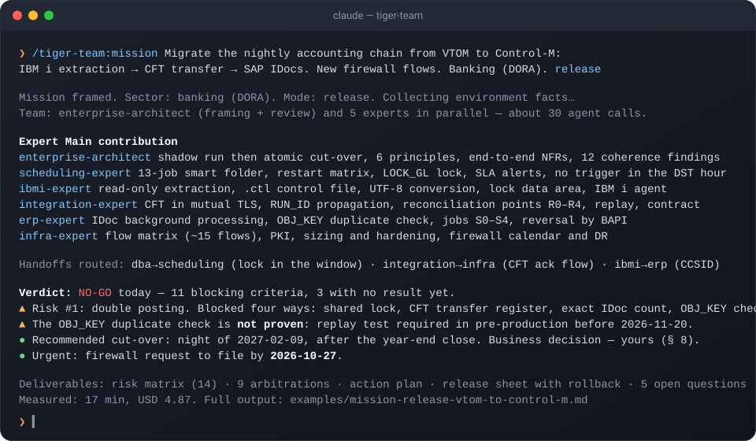
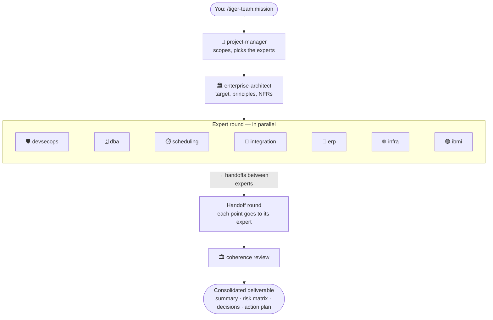

<div align="center">

# 🐯 Tiger Team

**Nine senior experts. One command. Your integration project, reviewed from every angle.**

A squad of expert agents for technical and application integration projects, built for [Claude Code](https://code.claude.com) and for regulated sectors: banking, healthcare, defense.

[](https://code.claude.com/docs/en/plugins)
[](https://github.com/Crapule421/tiger-team/tags)
[](https://github.com/Crapule421/tiger-team/actions/workflows/ci.yml)
[](LICENSE)

[Quick start](#-quick-start) · [The team](#-the-team) · [How they work together](#-how-they-work-together) · [Commands](#-commands) · [Examples](examples/) · [Confidentiality](#-confidentiality) · [Roadmap](#%EF%B8%8F-roadmap-and-contributions-wanted) · [🇫🇷 Français](#-tiger-team-en-français)

</div>

---

A *tiger team* is a group of senior specialists brought together to crack a hard problem. This plugin gives you nine of them. Ask one question and a project manager scopes it, an enterprise architect frames the target, the right experts work in parallel, trade their findings, and hand you a consolidated answer: risks, decisions, action plan and the deliverable you need.

```
/tiger-team:mission Migrate the nightly accounting chain from VTOM to Control-M:
IBM i extraction → CFT transfer → SAP IDocs. Banking context (DORA). release
```

> 17 minutes later: architect framing, five experts, a handoff round, a coherence review, a go/no-go verdict, a 9-decision arbitration log and a timed release sheet with rollback. Real run, fictitious data — [read the full output](examples/mission-release-vtom-to-control-m.md).

<p align="center">
  
</p>

## 🚀 Quick start

```bash
claude plugin marketplace add Crapule421/tiger-team
claude plugin install tiger-team@tiger-team
```

Then, inside Claude Code:

```
/tiger-team:mission <your topic> [scoping|review|incident|release|quick]
```

or call one expert directly, for example `/tiger-team:sql-release-review ./release/V42__add_index.sql`.

<details>
<summary>Other ways to install and run</summary>

- From inside Claude Code: `/plugin marketplace add Crapule421/tiger-team`, then `/plugin install tiger-team@tiger-team`.
- Update: `/plugin marketplace update tiger-team`.
- Run a whole session as the project manager: `claude --agent tiger-team:project-manager`.
- Call an expert in plain language ("ask the tiger-team dba-expert to…") or with `@`.
- Offer the team to everyone on a project, in its `.claude/settings.json`:

  ```json
  {
    "extraKnownMarketplaces": {
      "tiger-team": { "source": { "source": "github", "repo": "Crapule421/tiger-team" } }
    },
    "enabledPlugins": { "tiger-team@tiger-team": true }
  }
  ```

Requires Claude Code (tested with 2.1.292). The confidentiality guard needs `bash`, which Claude Code already uses on Windows (Git Bash).

**Let the experts read their reference files without prompts.** The knowledge bases live in the plugin's install folder, outside your project, so each `Read` of a reference file asks for permission (and is refused in `claude -p`). Add this allow rule once to `~/.claude/settings.json`:

```json
{
  "permissions": {
    "allow": ["Read(~/.claude/plugins/cache/tiger-team/**)"]
  }
}
```

The path is where Claude Code caches plugins installed from the marketplace; adjust it if you installed from a local clone (`claude plugin list` shows the location).

</details>

## 👥 The team

| | Agent | Brings to the table |
|---|---|---|
| 🎯 | **project-manager** | Team lead. Scoping, planning, RACI, RAID, governance, test strategy, cut-over, go/no-go, rollback, hypercare, arbitration between experts |
| 🏛️ | **enterprise-architect** | Design authority. TOGAF, ArchiMate, IS urbanisation, target architecture, ADRs, NFRs, cloud and sovereignty, coherence review |
| 🛡️ | **devsecops-expert** | CI/CD (GitLab CI, Jenkins, Azure DevOps, GitHub Actions), IaC (Terraform, Ansible), containers, Kubernetes/OpenShift, secrets, SAST/DAST/SCA/SBOM, hardening |
| 🗄️ | **dba-expert** | Oracle, PostgreSQL, SQL Server, Db2, MySQL: performance, HA/DR, backup, security, migrations, release scripts |
| ⏱️ | **scheduling-expert** | VTOM, Dollar Universe, Control-M: batch chains, calendars, dependencies, restart, scheduler migrations |
| 🔀 | **integration-expert** | REST/SOAP APIs, ESB/iPaaS, MFT (Axway CFT, Sterling), IBM MQ, Kafka, formats (ISO 20022, SEPA, EDI, HL7/FHIR), interface contracts |
| 🧾 | **erp-expert** | SAP, Oracle EBS/Fusion, Sage X3, Cegid, Dynamics 365: O2C, P2P, R2R, ERP interfaces, data migration |
| 🌐 | **infra-expert** | Network, firewalls, flow matrices, DNS, TLS/PKI, Linux (RHEL, Debian, SUSE), Windows Server (AD, GPO, IIS) |
| 🟢 | **ibmi-expert** | IBM i / AS400: RPG, CL, COBOL, Db2 for i, jobs, journaling, security, integration with the rest of the IS |

Every expert is a Claude Code subagent (`tiger-team:<name>`) with a preloaded knowledge base, the confidentiality rules of the regulated sectors, and the same answer format: **Summary · Analysis · Recommendations · Risks · Handoffs · Open questions · Assumptions**. They answer in your language.

**They ask before they guess.** Each expert knows which facts about *your* environment would change its answer (scheduler version and New Day time, database edition and HA topology, firewall change process, ERP release, IBM i PTF level…) and where to find them. In a conversation it asks you up to five precise questions, each with why it matters and how to obtain the answer; when it runs from a command it states explicit assumptions and lists the checks to run instead. What it says is labelled **Fact** (with its source), **Inference** or **Assumption**, and every product statement is version-qualified. Record your environment once with `/tiger-team:discover`: it writes `docs/tiger-team/environment.md`, which every expert reads before answering.

## 🤝 How they work together



The `Handoffs` section is what makes nine agents behave like a team. The DBA flags a long-running lock, so the scheduling expert moves the batch window. The integration expert adds a CFT acknowledgment flow, so the infra expert adds it to the flow matrix. The lead routes every point, arbitrates conflicts (compliance > security > data integrity > availability > delay > cost) and writes the arbitration down.

| Mode | For | You get |
|---|---|---|
| `solo` | a single-domain question | no subagent: the lead reads the knowledge base and answers |
| `quick` | a cross-domain question, 2-3 domains | one expert round in parallel, short consolidated answer |
| `scoping` | a new project or change | scoping note, RACI, RAID, experts to involve |
| `review` | an existing design, chain, interface or plan | prioritized findings report |
| `incident` | something broken in production | diagnosis, recovery plan, follow-up actions |
| `release` | a go-live being prepared | release sheet, go/no-go criteria, rollback plan |

The lead sizes the team before launching: one domain → `solo` or a direct command; two or three → `quick`; more, or a deliverable → a full mission. Never more than four experts unless you ask.

### Why nine experts, and when one is enough

The split is by **knowledge base**, not by job title: the Control-M Automation API, SAP IDoc handling, IBM i journaling and DORA incident clocks do not fit one context window, so each expert carries its own, loaded only when it runs. The second reason is **independent judgement**: experts answer in isolation, and what the mission buys is their disagreement, surfaced by the architect's coherence review and the lead's arbitration.

That value exists only on cross-domain topics. On a single-domain question, nine contexts are waste: use a direct command or `solo`. Handoffs between experts are typed objects (`→ expert | claim | evidence | needs`), routed by the lead without re-sending anyone's full answer, so the second round costs a fraction of the first and does not reopen settled points.

> **Cost.** A full mission is 20 to 40 agent calls: expect 10 to 20 minutes and a few dollars of API usage (measured: about 5 USD for the example above on 1.0.0). A `quick` mission with three experts measured 3.4 USD on 1.2.0; a direct command about 1 to 2 USD. Figures depend on your model and on the other plugins loaded in your session.
>
> **Model routing.** In `quick` mode the lead runs the experts on Sonnet by default (measured −51 % on the same mission, same structure and arbitration); in `scoping`, `review`, `incident` and `release` they run on the session's model. The architect's framing and coherence review and the lead's arbitration always stay on the session's model, where judgement changes the answer. Override with a word in the request ("experts on the session model"), or set `CLAUDE_CODE_SUBAGENT_MODEL` for every subagent.
>
> **What the agents read is data.** Exports, scripts, logs, documents and pasted web content are analysed and quoted as evidence, never obeyed: an instruction found inside a file is reported as a finding. This is the cheapest defence against indirect prompt injection, and every agent and command carries it.

### Measured costs

Same prompt each time (a `quick` mission on exposing IBM i account balances through a REST API, three experts), run headless with `claude -p`, session model Fable 5.1, reference reads allowed by the rule above unless stated.

| Run | Version | Experts' model | Cost | Note |
|---|---|---|---|---|
| `quick`, 3 experts | 1.2.0 | session model | 3.43 USD | experts read 4 reference files |
| `quick`, 3 experts | 1.3.0 | session model | 4.04 USD | experts now read reference sections as briefed (12 reads): more sourced facts, more tokens |
| `quick`, 3 experts, reads refused (no allow rule) | 1.3.0 | session model | 4.32 USD | refused reads and retries cost more than the reads themselves |
| `quick`, 3 experts, `CLAUDE_CODE_SUBAGENT_MODEL=sonnet` | 1.3.0 | Sonnet | **1.98 USD** | −51 % versus the session model, same structure and arbitration in the output |
| full `release` mission, architect + 5 experts, handoff round, coherence review | 1.0.0 | Opus 5.5 (session) | 4.87 USD | 17 minutes, 77 model calls |
| same prompt, architect + 4 experts | 1.3.0 | Fable 5.1 (session) | 21.48 USD | 9.5 minutes, 144 model calls: typed handoffs worked, but experts made 60 Read/Grep/Glob calls (section-by-section reads, searches for the environment sheet) and the session model is pricier — not comparable to the line above |

What the numbers say: **the cost of a mission is the per-call context multiplied by the number of model calls.** Every tool call an expert makes re-sends its whole context (here 100 to 150k cached tokens per call, most of it the descriptions of every plugin loaded in the session). So reading a reference file in slices, or searching for a file that does not exist, costs more than reading the file once in full. Version 1.3.1 therefore makes experts read a named file once and never explore, and tells them whether an environment sheet exists. The two other levers are yours: run the experts on a cheaper model (−51 % measured on `quick`), and disable the plugins you do not use in the session, since their descriptions sit in every call. Each line is one run; expect ±15 % between runs.

## ⚡ Commands

| Command | Expert | Produces |
|---|---|---|
| `/tiger-team:discover` | 🎯 project-manager (interactive) | the environment sheet `docs/tiger-team/environment.md`, built from an interview about your organization's environment |
| `/tiger-team:scoping` | 🎯 project-manager | scoping note, RACI, RAID, experts to involve |
| `/tiger-team:release-plan` | 🎯 project-manager | release sheet, go/no-go criteria, rollback plan |
| `/tiger-team:adr` | 🏛️ enterprise-architect | architecture decision record or target-architecture note |
| `/tiger-team:security-review` | 🛡️ devsecops-expert | security review of a pipeline, IaC, Dockerfile, manifest or config |
| `/tiger-team:sql-release-review` | 🗄️ dba-expert | review of a SQL release script, with rollback |
| `/tiger-team:batch-review` | ⏱️ scheduling-expert | review of a batch chain |
| `/tiger-team:scheduler-convert` | ⏱️ scheduling-expert | conversion between VTOM, Dollar Universe and Control-M |
| `/tiger-team:interface-contract` | 🔀 integration-expert | interface specification |
| `/tiger-team:erp-interface-review` | 🧾 erp-expert | analysis of an ERP inbound or outbound interface |
| `/tiger-team:flow-matrix` | 🌐 infra-expert | network flow matrix and firewall requests |
| `/tiger-team:ibmi-review` | 🟢 ibmi-expert | analysis of an RPG/CL/COBOL program, job or IBM i interface |

Each command takes a description or a file path. Except `discover`, a command runs in the expert's own context and never asks you questions: when something is missing, it states its assumptions and lists, under *Open questions*, the exact checks that would close them.

## 📚 What is inside

- **9 knowledge bases**, one per expert, with detailed reference files loaded on demand (Control-M Automation API, Dollar Universe, VTOM, SAP IDoc/BAPI/OData, ISO 20022 and SEPA, HL7 and FHIR, Axway CFT, Terraform, PostgreSQL, Oracle, IBM i…). Every reference file ends with the official sources it was checked against. Where no public official source settles a point (a vendor's behaviour that varies by version, a law not yet promulgated), the text says *verify against your version* instead of guessing: you will meet that phrase, and it is deliberate.
- **Real example outputs** in [`examples/`](examples/): a full mission, a quick mission and a direct command, unedited, with their measured cost.
- **Sector compliance** references: DORA, NIS2, EBA, ACPR, PCI DSS, AML/CFT and banking secrecy; HDS, GDPR article 9, PGSSI-S, INS and CI-SIS; IGI 1300, II 901, homologation and ANSSI qualifications. Informational, not legal advice.
- **9 deliverable templates**: DAT, DEX, release sheet (fiche MEP), interface contract, flow matrix, RACI, RAID, UAT sign-off (PV de recette), environment sheet.
- **Discovery protocol**: what each expert must know about your environment, how to obtain it (commands, console paths, documents), and the factual discipline every answer follows.
- **A confidentiality guard** (below).

## 🔒 Confidentiality

Claude Code sends your prompts and the files it reads to a cloud API. **Tiger Team knows the regulations of sensitive sectors, but it must never receive sensitive data:**

| Sector | Never | The team can still help with |
|---|---|---|
| Defense | classified information (Secret, Très Secret), Diffusion Restreinte information — processed only on homologated systems (IGI 1300, II 901) | methods, templates, generic scripts, anonymized architectures |
| Healthcare | real patient data (HDS hosting rules, GDPR article 9) | pseudonymized or synthetic data, schemas, HL7/FHIR structure |
| Banking | customer data, secrets, production credentials | anonymized flows, formats, controls, reconciliation design |

Follow your organization's AI usage policy.

### Built-in guard

The plugin ships a hook (`plugins/tiger-team/hooks/confidentiality-guard.sh`, bash only, no dependency) that blocks:

- reading, editing or searching **secret files**: `.env` (but not `.env.example`), `*.pem`, `*.key`, `*.p12`, `*.pfx`, `*.jks`, `*.keystore`, `*.kdbx`, `*.ppk`, `*.p8`, `id_rsa*`, `id_ed25519*`, `credentials.*`, `.netrc`, `.pgpass`, `.htpasswd`;
- reading a file that carries a **French classification marking** written in upper case, as on marked documents (Secret Défense, Très Secret, Diffusion Restreinte, Spécial France, Confidentiel Défense; accents optional; UTF-8 and Latin-1);
- **Bash commands** that target secret files;
- **prompts** that contain such a marking.

It is covered by 30 tests (`tests/confidentiality-guard.test.sh`) that run in CI. Limits: it cannot see inside binary formats (PDF, Office files); if the script itself fails, the call goes through (Claude Code 2.1.295+ supports `"onFailure": "block"`); and it is a safety net against mistakes, **not** a substitute for a security policy or a homologation.

<details>
<summary>Recommended settings for sensitive projects</summary>

Add deny rules to the project's `.claude/settings.json` (a plugin cannot set permissions for you):

```json
{
  "permissions": {
    "deny": [
      "Read(**/.env)", "Read(**/.env.*)",
      "Read(**/*.pem)", "Read(**/*.key)", "Read(**/*.p12)", "Read(**/*.pfx)",
      "Read(**/*.jks)", "Read(**/*.kdbx)", "Read(**/id_rsa*)", "Read(**/id_ed25519*)",
      "WebFetch", "WebSearch"
    ]
  }
}
```

The Tiger Team agents already have no web access (`WebFetch` and `WebSearch` are disallowed), and only the DevSecOps, DBA and infra experts have Bash, for local read-only checks.

**Persistent memory** (`memory: user` in an agent's frontmatter) is off, because it could retain client or project names between sessions. Turn it on in a fork only if your context allows it.

</details>

<details>
<summary>Option: agent teams (experimental)</summary>

Claude Code's experimental [agent teams](https://code.claude.com/docs/en/agent-teams) let teammates message each other and share a task list. They can be based on Tiger Team agents. Enable them for one session only:

```bash
CLAUDE_CODE_EXPERIMENTAL_AGENT_TEAMS=1 claude
```

Then ask: *"Create an agent team with tiger-team:integration-expert, tiger-team:scheduling-expert and tiger-team:infra-expert to …"*. Expect a much higher token cost, and note that skills are not preloaded into teammates. On Windows only the in-process display mode works. Keep the default orchestration (`/tiger-team:mission`) for everyday work.

</details>

## 🗺️ Roadmap and contributions wanted

The team is built by one integrator, from official documentation and field practice. It gets better with every practitioner who corrects a fact or adds a tool they run every day. Where help is most welcome:

| Area | Wanted | Why |
|---|---|---|
| **Scheduling** | Practitioners of VTOM and Dollar Universe to review `scheduling-reference/references/vtom.md` and `dollar-universe.md`; coverage of Broadcom AutoSys and IBM Workload Scheduler (IWS/TWS) | Their public documentation is thinner than Control-M's, so more facts are still flagged *verify* |
| **IBM i** | Review of `ibmi-reference` by RPG and operations people; IBM i scheduler agent specifics per tool | Legacy knowledge lives with practitioners, not online |
| **ERP** | Cegid and Sage X3 specifics; Oracle Fusion and Dynamics 365 integration patterns from real projects | Vendor docs cover the mechanisms, not the project traps |
| **Healthcare** | HL7 v2 / FHIR FR Core / INS flows from hospital integrators; HDS v2.1 once published | Interoperability specs move fast in France |
| **Mainframe** | A `zos-expert` (JCL, CICS, Db2 for z/OS, Control-M for z/OS) | Many banking batch chains still land there |
| **Templates** | DPIA (AIPD) skeleton, homologation dossier outline, interface test-plan template | Requested on regulated projects |
| **Quality** | An evaluation suite that replays the `examples/` prompts and checks the output structure; cheaper expert runs (per-agent `model` option) | Keep behaviour stable across Claude Code releases and cut the cost of a mission |
| **Languages** | Prompts stay in English; a French-first variant of the README and templates would help non-English teams | — |

Open a [fact correction](https://github.com/Crapule421/tiger-team/issues/new?template=fact_correction.yml) when a command, parameter or legal reference is wrong, a [feature request](https://github.com/Crapule421/tiger-team/issues/new?template=feature_request.yml) for a new expert or tool, or a [bug report](https://github.com/Crapule421/tiger-team/issues/new?template=bug_report.yml) when an agent misbehaves. Fictitious data only, always.

## 🧪 Evaluate the plugin

Behaviour is tested, not only syntax. `plugins/tiger-team/evals/` holds cases for Claude Code's [`claude plugin eval`](https://code.claude.com/docs/en/plugin-evals): a direct command that must flag a blocking index build, a scheduler conversion that must produce a valid Automation API JSON with typed handoffs, an expert asked without a version that must name the check instead of guessing, a prompt that must **not** auto-fire the mission orchestrator, and a prompt carrying sample customer data that must be refused without repeating it. Deterministic graders first (regex, tool calls), a short judged rubric where a regex cannot see.

```bash
cd plugins/tiger-team
claude plugin eval . --case mission-never-autofires --runs 1 --ablation none --no-publish   # 6 s, a few cents
claude plugin eval . --no-publish --max-cost-usd 25 --threshold 0.8                       # whole suite with the no-plugin baseline
```

Run the suite before a release and after any change to an agent, a skill or the orchestrator; add a case for every behaviour you fix. The `Evals` GitHub workflow runs it on demand when an `ANTHROPIC_API_KEY` secret is set.

## 🛠️ Customizing and contributing

Fork the repository and edit:

| What | Where |
|---|---|
| The experts: system prompt, tools, preloaded skills | `plugins/tiger-team/agents/*.md` |
| Their knowledge bases | `plugins/tiger-team/skills/*-reference/` (`SKILL.md` + `references/`) |
| Your own deliverable templates | `plugins/tiger-team/skills/deliverables/templates/` |
| The orchestration procedure | `plugins/tiger-team/skills/mission/SKILL.md` |

Test with `claude --plugin-dir plugins/tiger-team`, run `bash tests/lint.sh` and `bash tests/confidentiality-guard.test.sh`, then see [CONTRIBUTING.md](CONTRIBUTING.md). Keep public forks generic: no employer conventions, server names, client names or real data.

## ⚠️ Disclaimer

Tiger Team is an assistant. Its output must be reviewed by qualified people before use in production. Regulatory content is informational, may be out of date and is not legal advice.

## 📄 License

[MIT](LICENSE)

---

<div align="center">

## 🇫🇷 Tiger Team en français

**Neuf experts seniors. Une commande. Ton projet d'intégration passé en revue sous tous les angles.**

</div>

Une équipe d'agents experts pour les projets d'intégration technique et applicative, dans Claude Code, pensée pour les secteurs régulés : banque, santé, défense. Neuf experts travaillent ensemble : chef de projet, architecte d'entreprise, DevSecOps, DBA, ordonnancement (VTOM, Dollar Universe, Control-M), API et flux, ERP, réseau et systèmes, IBM i (AS400). Ils te répondent en français si tu leur écris en français.

### Installation

```bash
claude plugin marketplace add Crapule421/tiger-team
claude plugin install tiger-team@tiger-team
```

### Utilisation

- **Toute l'équipe** : `/tiger-team:mission <sujet> [scoping|review|incident|release|quick]`. Le chef de projet cadre le sujet et choisit les experts utiles. Les experts travaillent en parallèle et s'échangent leurs points d'attention, puis l'architecte vérifie la cohérence de l'ensemble. Tu obtiens une synthèse, une matrice des risques, un plan d'action et le livrable : note de cadrage, rapport de revue, plan de reprise ou fiche MEP. Le mode `quick` répond à une question transverse en un seul tour, sans livrable.
- **Un seul expert** : les 11 commandes du tableau ci-dessus, par exemple `/tiger-team:scheduler-convert` pour convertir une chaîne VTOM en Control-M, ou `/tiger-team:flow-matrix` pour une matrice de flux.
- **Ton environnement, une fois pour toutes** : `/tiger-team:discover` t'interroge sur ton infrastructure (ordonnanceur et version, bases, middleware, ERP, réseau, IBM i, chaîne de livraison) et écrit `docs/tiger-team/environment.md`. Chaque expert le lit avant de répondre. Les experts demandent avant de supposer : en conversation, au plus cinq questions précises avec la raison et la façon d'obtenir la réponse ; en commande, des hypothèses explicites et la liste des vérifications à faire. Ce qu'ils affirment est étiqueté **Fait** avec sa source, **Déduction** ou **Hypothèse**.
- **Session pilotée par le chef de projet** : `claude --agent tiger-team:project-manager`.

Une mission complète représente 20 à 40 appels d'agents, soit 10 à 20 minutes et quelques dollars d'API. Pour une question qui ne concerne qu'un domaine, une commande directe coûte beaucoup moins.

### Confidentialité

Claude Code envoie les prompts et les fichiers lus à une API dans le cloud. L'équipe connaît les réglementations sensibles, mais ne doit jamais recevoir de données sensibles :

- **Défense** : aucune information classifiée (Secret, Très Secret) ni Diffusion Restreinte. Ces informations ne se traitent que sur des systèmes homologués (IGI 1300, II 901).
- **Santé** : aucune donnée patient réelle. Travaille sur des jeux pseudonymisés ou synthétiques (HDS, RGPD art. 9).
- **Banque** : ni données clients, ni secrets, ni identifiants de production. Respecte la politique IA de ton entreprise.

Le hook fourni bloque la lecture des fichiers de secrets et des documents qui portent un marquage de classification, les commandes Bash qui visent ces fichiers, et les prompts qui contiennent un tel marquage. C'est un filet de sécurité contre les erreurs de manipulation : il ne remplace ni une politique de sécurité ni une homologation.

### Avertissement

Tiger Team est un assistant : ses productions doivent être relues par des personnes qualifiées. Les contenus réglementaires sont informatifs et ne constituent pas un avis juridique.
