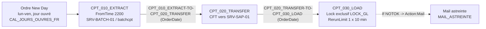

<!-- Tiger Team example output. Real run, unedited below this header. All names, hosts and figures are fictitious. -->

> **Example — direct command `/tiger-team:scheduler-convert`**
>
> | | |
> |---|---|
> | Command | `/tiger-team:scheduler-convert vtom to control-m : environnement PROD, application APP_COMPTA (serveur SRV-BATCH-01, compte batchcpt). Jobs : EXTRACT (script /opt/batch/extract.sh, 22h00 du lundi au vendredi hors jours fériés), TRANSFER (après EXTRACT OK, envoi CFT vers SRV-SAP-01), LOAD (après TRANSFER OK, ressource exclusive LOCK_GL ; en cas d'échec, relance une fois après 10 minutes puis mail à l'astreinte).` |
> | Expert | scheduling-expert, forked from the command (it cannot ask questions: it states assumptions and lists the checks to run) |
> | Plugin version | 1.2.0, 2026-10-23 |
> | Measured | about 4 minutes, USD 1.73 of API usage |
> | What to look at | the Control-M Automation API JSON (valid, `Resource:Lock`, `If` object), the list of points that do not convert 1:1, and the open questions with how to obtain each answer (`vtexport -x`, `ctm environment show`, `ctm deploy calendars::get`) |
> | Language | the prompt was in French, so the expert answered in French |

---

## Summary

- **Source → cible** : Visual TOM (version non précisée dans le brief ; référence utilisée : 6.7.1, ligne courante 8.x) → Control-M Automation API JSON (Assumption : 9.0.21 ou plus récent, donc `Resource:Lock` ; sinon `Resource:Mutex`). Références lues depuis `C:/tiger-team/plugins/tiger-team/skills/scheduling-reference/references/` (le cache du plugin n'était pas lisible ; même version 1.2.0).
- **Périmètre** : 1 environnement, 1 application, 3 jobs, 2 liens, 1 ressource exclusive, 1 planning + 1 calendrier, 1 définition de relance, 1 alarme mail = 11 objets. Aucun export ni script fourni : la conversion repose sur la description textuelle seule (voir Assumptions).
- **Couverture** : 6 objets 1:1 (jobs, liens, ressource, relance), 3 adaptés (environnement, planning/heure, alarme), 2 manuels (calendrier jours fériés, contexte queue/submitter) ≈ 55 % automatique, 30 % adapté, 15 % manuel.
- **Top 3 risques** : (1) `LOCK_GL` partagé avec d'autres applications VTOM pendant la coexistence : l'exclusion mutuelle ne traverse pas les deux ordonnanceurs ; (2) sémantique "TRANSFER OK" (fin de commande CFT vs accusé de réception) non documentée, et TRANSFER non idempotent à la relance ; (3) date de traitement : chaîne démarrant à 22h00 et pouvant franchir minuit, comportement différent entre changement de date VTOM et ODATE/New Day Control-M.

## Mapping table

Convention de nommage cible (proposée) : dossier `APP_COMPTA_DAILY` ; jobs `CPT_<nnn>_<FONCTION>` (pas de 10) ; événements `<PRODUCTEUR>-TO-<CONSOMMATEUR>` ; ressources : nom source conservé ; `Application` = `APP_COMPTA`, `SubApplication` = `DAILY`.

| Objet source (type : nom) | Objet cible (type : nom) | Conversion | Notes |
|---|---|---|---|
| Environnement : PROD | Serveur/EM de production + descripteur de déploiement (`ctm deploy <json> <descriptor>`) ; pas de préfixe dans le nom du dossier | adapted | L'étape de cycle de vie n'est pas un objet Control-M : elle se gère par serveur cible et descripteur. |
| Application : APP_COMPTA | `Folder` : APP_COMPTA_DAILY (`Application` = APP_COMPTA) | adapted | Le dossier porte le `When` hérité par les jobs, comme le planning d'application VTOM hérité. |
| Planning : 22h00, lun-ven hors jours fériés | `When` du dossier : `WeekDays` MON-FRI + `ConfirmationCalendars` `<CAL_JOURS_OUVRES_FR>` / `DoNotOrder` + `FromTime` 2200 | adapted / manual | Le calendrier doit exister dans Control-M (fériés = points manuels n°1). `DoNotOrder` = pas de décalage, comme VTOM "hors fériés" (Assumption : pas de report au jour ouvré suivant dans VTOM). |
| Job : EXTRACT (`/opt/batch/extract.sh`) | `Job:Script` : CPT_010_EXTRACT | 1:1 | Argument `%%$ODATE` ajouté (Assumption : le script lit `TOM_DATE_VALUE` aujourd'hui, à vérifier). |
| Job : TRANSFER (envoi CFT vers SRV-SAP-01) | `Job:Script` : CPT_020_TRANSFER | 1:1 (technique) | Script non fourni : placeholder. CFT reste l'outil de transfert ; pas de bascule vers Control-M MFT. Sémantique "OK" à confirmer (point manuel n°4). |
| Job : LOAD | `Job:Script` : CPT_030_LOAD | 1:1 | Script non fourni : placeholder. |
| Lien obligatoire EXTRACT → TRANSFER | `AddEvents` / `WaitForEvents` / `DeleteEvents` : CPT_010_EXTRACT-TO-CPT_020_TRANSFER, date `OrderDate` | 1:1 | Événement produit seulement sur fin OK (défaut Control-M = lien obligatoire VTOM). Consommé par le successeur. |
| Lien obligatoire TRANSFER → LOAD | Événements : CPT_020_TRANSFER-TO-CPT_030_LOAD, date `OrderDate` | 1:1 | Idem. |
| Ressource poids max 1 : LOCK_GL (prise par LOAD) | `Resource:Lock` `LockType: Exclusive` : LOCK_GL sur CPT_030_LOAD | 1:1 | Aucune capacité serveur à déclarer pour un lock (contrairement à un pool). Tous les autres utilisateurs de LOCK_GL doivent migrer ensemble (risque n°1). |
| Relance : type Automatique, 1 relance, délai 00:10:00 (LOAD) | `RerunLimit` `{Every 10, Minutes, Times 1}` sur CPT_030_LOAD | 1:1 | Même sémantique : rejeu complet du script ; aucune reprise à l'étape. |
| Alarme : mail astreinte si LOAD en erreur après relance | `If` `NOTOK` → `Action:Mail` `<MAIL_ASTREINTE>` sur CPT_030_LOAD, message avec `%%RUNCOUNT` | adapted | L'If s'exécute à chaque fin NOTOK : 2 mails si la relance échoue (le 1er "relance auto dans 10 min", le 2e actionnable). Équivalence stricte "mail seulement après épuisement" : voir "Verify against your version". |
| Machine : SRV-BATCH-01 | `Host` : SRV-BATCH-01 (agent Control-M) | 1:1 | L'agent doit être installé et enregistré (`ctm config server:agents::get`). |
| Unité de soumission : batchcpt | `RunAs` : batchcpt | 1:1 | Compte à autoriser côté agent (point manuel n°6). |
| Queue / submitter VTOM (non décrit) | Aucun équivalent direct | manual | Profil, umask, LANG, redirection de logs chargés par `tom_submit.<queue>` : à reproduire sur l'agent (point manuel n°5). |

## Dependency graph



Pas de branche "en erreur" pour EXTRACT et TRANSFER dans le brief : en VTOM les successeurs sont déprogrammés ; en Control-M ils restent en `Wait Condition` jusqu'à expiration de `DaysKeepActive`. Pour éviter un échec silencieux, un `If NOTOK → Action:Mail` est ajouté aussi sur ces deux jobs (ajout explicite, à aligner avec la matrice d'alertes VTOM réelle : question ouverte n°4).

## Target definition

```json
{
  "Defaults": {
    "Application": "APP_COMPTA",
    "SubApplication": "DAILY",
    "Host": "SRV-BATCH-01",
    "RunAs": "batchcpt",
    "DaysKeepActive": "1"
  },
  "APP_COMPTA_DAILY": {
    "Type": "Folder",
    "ControlmServer": "<CTM_SERVER>",
    "Description": "Chaine quotidienne APP_COMPTA : extraction GL, transfert CFT vers SRV-SAP-01, chargement GL. Converti depuis VTOM PROD/APP_COMPTA.",
    "When": {
      "WeekDays": ["MON", "TUE", "WED", "THU", "FRI"],
      "FromTime": "2200",
      "ConfirmationCalendars": {
        "Calendar": "<CAL_JOURS_OUVRES_FR>",
        "ExceptionPolicy": "DoNotOrder"
      }
    },
    "CPT_010_EXTRACT": {
      "Type": "Job:Script",
      "FileName": "extract.sh",
      "FilePath": "/opt/batch",
      "Arguments": ["%%$ODATE"],
      "Description": "Extraction comptable pour la date de traitement %%$ODATE (ex VTOM EXTRACT)",
      "eventsToAdd": {
        "Type": "AddEvents",
        "Events": [
          { "Event": "CPT_010_EXTRACT-TO-CPT_020_TRANSFER" }
        ]
      },
      "IfNotOK": {
        "Type": "If",
        "CompletionStatus": "NOTOK",
        "MailAstreinte": {
          "Type": "Action:Mail",
          "To": "<MAIL_ASTREINTE>",
          "Subject": "[APP_COMPTA] %%JOBNAME en erreur - ODATE %%$ODATE - run %%RUNCOUNT",
          "Message": "Chaine APP_COMPTA_DAILY arretee : TRANSFER et LOAD ne demarreront pas. Voir run book RB-CPT-010.",
          "Urgency": "Urgent"
        }
      }
    },
    "CPT_020_TRANSFER": {
      "Type": "Job:Script",
      "FileName": "<TRANSFER_SCRIPT>",
      "FilePath": "<SCRIPT_DIR>",
      "Arguments": ["%%$ODATE"],
      "Description": "Envoi CFT du fichier d'extraction vers SRV-SAP-01 (ex VTOM TRANSFER). Non idempotent : voir run book avant relance.",
      "eventsToWaitFor": {
        "Type": "WaitForEvents",
        "Events": [
          { "Event": "CPT_010_EXTRACT-TO-CPT_020_TRANSFER" }
        ]
      },
      "eventsToDelete": {
        "Type": "DeleteEvents",
        "Events": [
          { "Event": "CPT_010_EXTRACT-TO-CPT_020_TRANSFER" }
        ]
      },
      "eventsToAdd": {
        "Type": "AddEvents",
        "Events": [
          { "Event": "CPT_020_TRANSFER-TO-CPT_030_LOAD" }
        ]
      },
      "IfNotOK": {
        "Type": "If",
        "CompletionStatus": "NOTOK",
        "MailAstreinte": {
          "Type": "Action:Mail",
          "To": "<MAIL_ASTREINTE>",
          "Subject": "[APP_COMPTA] %%JOBNAME en erreur - ODATE %%$ODATE - run %%RUNCOUNT",
          "Message": "Transfert CFT vers SRV-SAP-01 en erreur. Verifier le catalogue CFT avant toute relance (risque de double envoi). Run book RB-CPT-020.",
          "Urgency": "Urgent"
        }
      }
    },
    "CPT_030_LOAD": {
      "Type": "Job:Script",
      "FileName": "<LOAD_SCRIPT>",
      "FilePath": "<SCRIPT_DIR>",
      "Arguments": ["%%$ODATE"],
      "Description": "Chargement GL (ex VTOM LOAD). Lock exclusif LOCK_GL. Relance automatique 1 fois apres 10 min.",
      "LOCK_GL": {
        "Type": "Resource:Lock",
        "LockType": "Exclusive"
      },
      "RerunLimit": {
        "Every": "10",
        "Units": "Minutes",
        "Times": "1"
      },
      "eventsToWaitFor": {
        "Type": "WaitForEvents",
        "Events": [
          { "Event": "CPT_020_TRANSFER-TO-CPT_030_LOAD" }
        ]
      },
      "eventsToDelete": {
        "Type": "DeleteEvents",
        "Events": [
          { "Event": "CPT_020_TRANSFER-TO-CPT_030_LOAD" }
        ]
      },
      "IfNotOK": {
        "Type": "If",
        "CompletionStatus": "NOTOK",
        "MailAstreinte": {
          "Type": "Action:Mail",
          "To": "<MAIL_ASTREINTE>",
          "Subject": "[APP_COMPTA] %%JOBNAME en erreur - ODATE %%$ODATE - run %%RUNCOUNT sur 2",
          "Message": "Run 1 : relance automatique dans 10 min. Run 2 : relance epuisee, intervention astreinte requise. Run book RB-CPT-030.",
          "Urgency": "VeryUrgent"
        }
      }
    }
  }
}
```

**Verify against your version** (avant `ctm build`) :

- Version de l'Automation API : si < 9.0.20.025, remplacer `Resource:Lock` / `LockType` par `Resource:Mutex` / `MutexType`.
- `<CAL_JOURS_OUVRES_FR>` : nom exact d'un calendrier existant (jours ouvrés hors fériés français) ; `ConfirmationCalendars` + `DoNotOrder` : confirmer sur votre version que le jour non confirmé n'est pas ordonné (sans décalage). Alternative si votre site préfère `WeekDaysCalendar` : à tester par forecast.
- `<CTM_SERVER>`, `<MAIL_ASTREINTE>`, `<TRANSFER_SCRIPT>`, `<LOAD_SCRIPT>`, `<SCRIPT_DIR>` : placeholders à substituer (descripteur de déploiement ou édition).
- `Action:Mail` suppose un serveur SMTP configuré dans Control-M/EM ; sinon utiliser `Action:Notify` vers une destination d'alerte raccordée à la supervision.
- Mail "seulement après épuisement de la relance" : vérifier dans la documentation de votre version si `If:NumberOfReruns` (`"NumberOfReruns": ">=1"`) peut se combiner avec `CompletionStatus: NOTOK` dans un même bloc ; je n'ai pas de source confirmant la combinaison, d'où le design par `%%RUNCOUNT`.
- `DaysKeepActive: "1"` dans `Defaults` : confirmer que la clé est acceptée dans `Defaults` sur votre version (sinon la répéter sur chaque job).
- `SiteStandard` : si un standard de site est imposé sur le serveur, l'ajouter au dossier et adapter les noms.
- Pas de clé `TimeZone` : les heures sont celles du Control-M/Server (Assumption : Europe/Paris).

Commandes :

```
ctm build  APP_COMPTA_DAILY.json
ctm deploy APP_COMPTA_DAILY.json <descriptor_PROD.json>
ctm run order <CTM_SERVER> APP_COMPTA_DAILY
ctm run forecast:timeline::get -s "filterType=year&year=2027&folder=APP_COMPTA_DAILY"
```

## Manual points (do not convert 1:1)

| # | Point | Comportement source | Design cible proposé | Owner | Status |
|---|---|---|---|---|---|
| 1 | Calendrier jours fériés | Calendrier VTOM "hors jours fériés" (jeu de fériés et propriétaire inconnus) | Calendrier Control-M `<CAL_JOURS_OUVRES_FR>` reconstruit depuis la définition métier (fériés nationaux, Alsace-Moselle ?), propriétaire nommé, revue annuelle avant Q4 ; comparaison forecast 13 mois | scheduling-expert + métier compta | Ouvert |
| 2 | Date de traitement | Date d'exploitation VTOM (mode de changement inconnu : Automatique / Système / Constante) ; LOAD peut tourner après minuit | ODATE Control-M = jour de l'ordre (New Day). Vérifier que New Day est avant 22h00 et après la fin de chaîne, et quelle date VTOM reçoit réellement LOAD aujourd'hui après minuit (défaut latent à ne pas migrer en silence) | scheduling-expert | Ouvert |
| 3 | Fenêtre et cut-off | Aucune heure limite décrite (défaut VTOM 23:59:59 = illimitée) | Ajouter `Notify:DoesNotStart` / `Notify:DoesNotEnd` dès que le cut-off (disponibilité SAP, sauvegardes) est connu | scheduling-expert + erp-expert | Ouvert |
| 4 | Sémantique "TRANSFER OK" et idempotence | Le lien obligatoire se déclenche au code retour 0 du script CFT ; on ignore si c'est la fin de la commande d'envoi ou l'accusé de réception | Faire attendre l'ack CFT (script ou job de contrôle) ; documenter la relance : vérifier le catalogue CFT avant renvoi (double envoi vers SAP) | integration-expert | Ouvert |
| 5 | Queue / submitter VTOM | `tom_submit.<queue>` charge potentiellement profil, umask, LANG, redirections | Reproduire dans un wrapper ou le profil de `batchcpt` sur l'agent ; tester un run avec `env` en sortie des deux côtés | infra-expert | Ouvert |
| 6 | Compte d'exécution | Unité de soumission batchcpt | `RunAs: batchcpt` ; vérifier les autorisations agent (mode d'exécution UNIX, utilisateurs permis) et l'absence de secret dans les scripts | infra-expert + devsecops-expert | Ouvert |
| 7 | Alarmes et consignes | Alarme mail astreinte sur LOAD ; autres alarmes (environnement, non démarrage) non décrites | If NOTOK → mail sur les 3 jobs (ajout), raccordement des alertes EM à la supervision/ticketing ; consignes VTOM → `Description` + `DocumentationUrl` (run book) | scheduling-expert | Ouvert |
| 8 | Ressource LOCK_GL partagée | Poids max 1 probablement utilisé par d'autres applications VTOM | Migrer tous les consommateurs de LOCK_GL dans la même vague, ou pont temporaire documenté (daté) pendant la coexistence | scheduling-expert + project-manager | Ouvert |
| 9 | Rétention logs/sorties | Rétention agent VTOM | Rétention Control-M (sorties de jobs, événements datés à purger) | infra-expert | Ouvert |

## Script changes

Aucun script fourni : la liste ci-dessous indique ce qu'il faut chercher (`grep -nE 'TOM_|tsend|tval|tfile|tgetdate|tmail|date \+' /opt/batch/*.sh`) et le changement requis.

| Script | Ligne / motif | Changement requis |
|---|---|---|
| /opt/batch/extract.sh | `TOM_DATE_VALUE`, `TOM_DATE`, `tgetdate` | Lire la date depuis l'argument `$1` (= `%%$ODATE`, AAAAMMJJ) ; échec immédiat si absent. |
| /opt/batch/extract.sh | `TOM_JOB`, `TOM_APPLICATION`, `TOM_ENVIRONMENT`, `TOM_JOB_RETRY`, `TOM_JOB_POINT` | Remplacer par des arguments (`%%JOBNAME`, `%%APPLIC`, `%%RUNCOUNT`) ou supprimer ; toute logique de reprise sur `TOM_JOB_POINT` devient un paramètre explicite. |
| /opt/batch/extract.sh | `tsend -s`, `tval`, `tmail`, `tfile`, `tpush`/`tpop` | Supprimer : le statut vient du code retour (0 = OK, ≠0 = erreur) ; valeurs partagées → variables Control-M ou événements ; mails → `Action:Mail`. |
| `<TRANSFER_SCRIPT>` | commande d'envoi CFT, test de l'ack | Confirmer le mode synchrone/attente d'ack ; marquer "déjà envoyé" pour rendre la relance sûre. |
| `<LOAD_SCRIPT>` | `exit 0` final inconditionnel, `\|\| true`, date système | Contrat de code retour strict (`set -e`, `pipefail`), scope par date de traitement, nettoyage du staging en première étape (idempotence pour la relance automatique). |

## Validation plan

1. **Statique** : `ctm build APP_COMPTA_DAILY.json` sans erreur après substitution des placeholders ; noms conformes au standard de site. Critère : build OK, revue par les pairs du JSON sous Git.
2. **Calendrier** : `vtplan` (source) vs `ctm run forecast:timeline::get` (cible) sur 13 mois (couvre fin d'année, Pâques/Ascension/Pentecôte, les deux week-ends DST). Critère : mêmes jours planifiés, chaque écart expliqué et accepté par le métier.
3. **Graphe** : 3 nœuds, 2 arêtes, événements datés `OrderDate`, lock exclusif sur LOAD. Critère : `ctm run job::waitingInfo` sur TRANSFER et LOAD montre exactement l'événement attendu.
4. **Dry run en environnement de test** : exécution bout en bout avec des scripts réels sur données de test ; puis tests d'échec : (a) EXTRACT en erreur → TRANSFER ne démarre pas, mail reçu ; (b) TRANSFER en erreur → LOAD ne démarre pas, mail reçu, procédure "vérifier CFT avant relance" appliquée ; (c) LOAD en erreur → relance automatique à +10 min observée, second échec → mail "run 2 sur 2" ; (d) LOAD avec un autre job tenant LOCK_GL → attente puis démarrage à la libération ; (e) kill de LOAD → LOCK_GL libéré. Critère : chaque scénario conforme et consigné dans le run book.
5. **Date de traitement** : forcer un run après minuit (ordre de la veille) et vérifier que `%%$ODATE` reçu par LOAD est bien la date d'ordre ; comparer au comportement VTOM observé. Critère : même date métier dans les deux outils.
6. **Run en parallèle** (si faisable) : chaîne Control-M en mode `RunAsDummy: true` sur les 3 jobs pendant au moins un cycle incluant une fin de mois ; comparer heures de démarrage et dépendances. Critère : zéro écart non expliqué.
7. **Bascule** : gel des changements, dernier `vtexport -x` archivé, déploiement Control-M, désactivation de l'application VTOM le même soir, surveillance renforcée 5 nuits, rollback = réactivation VTOM + suppression de l'ordre Control-M. Critère : décision go/no-go documentée, rollback testé en préprod.

## Risks

| Risk | Criticality | Mitigation |
|---|---|---|
| LOCK_GL encore utilisé par des jobs VTOM pendant la coexistence : deux écrivains sur le GL | Critical | Inventorier les consommateurs (`vtexport -x` + grep LOCK_GL) ; migrer en une vague ou pont temporaire daté. |
| TRANSFER relancé après un envoi CFT partiel/complet : double fichier vers SAP | High | Contrôle du catalogue CFT dans le script, drapeau "déjà envoyé", consigne de relance dans le run book. |
| Date de traitement décalée d'un jour après minuit (New Day vs changement de date VTOM) | High | Point manuel n°2 ; test de validation n°5 ; scripts lisant uniquement l'argument de date. |
| Calendrier fériés incomplet ou non maintenu (run un jour férié ou non-run un jour ouvré) | High | Calendrier reconstruit depuis la définition métier, propriétaire, forecast 13 mois, revue annuelle. |
| Échec silencieux : job en `Wait Condition` supprimé à expiration de `DaysKeepActive` | Medium | If NOTOK → mail sur les 3 jobs ; `Notify:DoesNotStart` dès que le cut-off est connu ; alertes EM raccordées à la supervision. |
| Environnement d'exécution différent (submitter VTOM vs agent Control-M) : encodage, PATH, umask | Medium | Wrapper/profil reproduit, test comparatif `env`, point manuel n°5. |
| Version Automation API < 9.0.20.025 : `Resource:Lock` rejeté par `ctm build` | Low | Vérifier la version, basculer sur `Resource:Mutex` si nécessaire. |

## Handoffs

→ integration-expert : confirmer comment le script TRANSFER détermine "OK" (fin de commande CFT vs accusé de réception depuis SRV-SAP-01), et concevoir le contrôle "déjà envoyé" avant relance.
→ erp-expert : fenêtre de disponibilité de SRV-SAP-01 pour le chargement GL et calendrier de clôture (jours où LOAD doit être interdit ou décalé).
→ infra-expert : agent Control-M sur SRV-BATCH-01, autorisation du `RunAs` batchcpt, reproduction du contexte du submitter VTOM, flux réseau agent ↔ Control-M/Server.
→ dba-expert : objets verrouillés par LOAD derrière LOCK_GL et collisions avec sauvegardes/maintenance entre 22h00 et la fin de chaîne.
→ devsecops-expert : JSON sous Git avec `ctm build` en CI et descripteurs de déploiement par environnement ; scan des scripts `/opt/batch` pour secrets en clair.
→ project-manager : inventaire des autres applications VTOM utilisant LOCK_GL pour planifier la vague de migration.

## Open questions

1. Versions exactes de VTOM (export `vtexport -x` de l'application) et de Control-M/Automation API (`ctm environment show`, page "About" de l'EM) ? Bloque : choix `Resource:Lock` vs `Resource:Mutex`, lecture des attributs réels (mode de restart, latest start, alarmes).
2. Mode de changement de date VTOM (Automatique / Système / Constante) et heure New Day Control-M ? Bloque : garantie que LOAD reçoit la même date métier dans les deux outils (point manuel n°2). Obtenir : objet date dans le client VTOM ; paramètre New Day sur le Control-M/Server.
3. Quel calendrier Control-M existe déjà pour les jours ouvrés français, qui le maintient, et le jeu de fériés VTOM inclut-il des jours régionaux ? Bloque : valeur de `<CAL_JOURS_OUVRES_FR>` et validité du forecast. Obtenir : `ctm deploy calendars::get`, export calendrier VTOM.
4. Existe-t-il des alarmes VTOM au niveau environnement/application (non démarrage, erreur) en plus du mail astreinte sur LOAD, et vers quelle supervision/ticketing ? Bloque : matrice d'alertes cible (point manuel n°7) et destination `Action:Mail` vs `Action:Notify`.
5. D'autres applications VTOM prennent-elles LOCK_GL, et restent-elles sur VTOM après la bascule ? Bloque : stratégie de coexistence (risque critique n°1). Obtenir : `grep LOCK_GL` sur l'export XML du domaine.
6. Comment le script TRANSFER constate-t-il le succès du transfert CFT (code retour de l'envoi, attente d'ack, `listcat`) ? Bloque : design de CPT_020_TRANSFER et sa procédure de relance.
7. Y a-t-il une heure limite métier (cut-off) pour la fin de LOAD ? Bloque : `Notify:DoesNotEnd` / `ToTime` et calcul du chemin critique.

Plusieurs de ces faits sont stables : je recommande `/tiger-team:discover` pour les consigner une fois dans `docs/tiger-team/environment.md` (absent aujourd'hui dans `C:/tiger-team`).

## Assumptions

1. Source identifiée comme VTOM d'après le brief ("vtom") ; version inconnue, référence 6.7.1 utilisée ; cible Control-M Automation API supposée ≥ 9.0.21 (clés `Resource:Lock`, `If:VariableValue` non utilisée).
2. Aucun export ni script n'a été fourni : la conversion reflète la description textuelle ; les attributs non décrits (latest start, type de restart des autres jobs, consignes, paramètres) sont supposés par défaut VTOM.
3. Convention de nommage cible : dossier `APP_COMPTA_DAILY`, jobs `CPT_010/020/030_<FONCTION>`, événements `<PRODUCTEUR>-TO-<CONSOMMATEUR>`, ressource `LOCK_GL` conservée.
4. L'environnement VTOM "PROD" est traduit par le serveur Control-M de production via descripteur de déploiement, pas par le nom du dossier.
5. Le planning "22h00 lun-ven hors fériés" est porté par l'application VTOM et hérité par les jobs ; il est placé au niveau du dossier. "Hors fériés" = pas d'exécution ce jour, sans report (`DoNotOrder`).
6. Les scripts reçoivent la date de traitement en argument `%%$ODATE` (AAAAMMJJ) ; aujourd'hui ils utilisent probablement `TOM_DATE_VALUE` (à vérifier par grep).
7. Fuseau : Control-M/Server et agent en Europe/Paris, pas de `TimeZone` sur les jobs. New Day supposé avant 22h00 et après la fin de chaîne (à confirmer, question n°2).
8. Scripts TRANSFER et LOAD non nommés dans le brief : placeholders `<TRANSFER_SCRIPT>`, `<LOAD_SCRIPT>`, `<SCRIPT_DIR>` ; le transfert reste sur Transfer CFT (pas de bascule vers Control-M MFT).
9. La ressource VTOM LOCK_GL est une ressource de type poids à maximum 1, prise uniquement par LOAD dans cette application.
10. `DaysKeepActive: "1"` est un ajout délibéré pour qu'une chaîne en retard survive au New Day ; VTOM n'a pas d'équivalent décrit.
11. Les `If NOTOK → Action:Mail` sur EXTRACT et TRANSFER sont des ajouts (anti-échec silencieux), pas une transcription d'alarmes VTOM existantes.
12. Placeholders : `<CTM_SERVER>`, `<CAL_JOURS_OUVRES_FR>`, `<MAIL_ASTREINTE>`, `<descriptor_PROD.json>`.