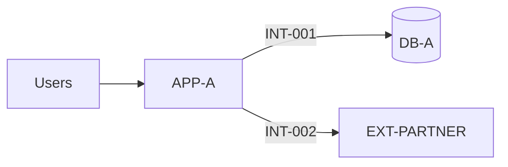

# Technical Architecture Document (Dossier d'Architecture Technique — DAT)

## 0. Document control

| Item | Value |
|---|---|
| Project / system | `<project name>` / `<system name>` |
| Document ID | `DAT-<system>-<nnn>` |
| Sensitivity label | `<Internal / Confidential / per organization policy>` |
| Status | `<Draft / In review / Approved / Obsolete>` |
| Audience | _Architects, infrastructure and security teams, operations, auditors, homologation committee_ |

| Version | Date | Author | Changes |
|---|---|---|---|
| 0.1 | `<YYYY-MM-DD>` | `<role>` | Initial draft |

| Role | Name / function | Decision | Date |
|---|---|---|---|
| Reviewer: security (RSSI) | `<...>` | `<OK / reservations>` | `<...>` |
| Reviewer: operations | `<...>` | | |
| Approver: architecture board | `<...>` | | |

Related documents: _requirements `<ref>`, ADR log `<ref>`, interface contracts `INT-xxx`, flow matrix `<ref>`, DEX `<ref>`, RAID `<ref>`._

## 1. Purpose and scope

_What this document describes, what it does not (out of scope), which releases it covers._

- In scope: `<components, environments, interfaces>`
- Out of scope: `<...>`

## 2. Context

### 2.1 Business context and drivers
_Business need, processes supported, users, criticality of the business functions (e.g. critical or important function under DORA)._

### 2.2 Constraints
| Type | Constraint | Source |
|---|---|---|
| Regulatory | _e.g. GDPR, DORA, PCI DSS, HDS, II 901_ | `<ref>` |
| Technical | _e.g. existing middleware, IBM i release, ERP version_ | |
| Organizational | _e.g. run outsourced, change windows, freeze periods_ | |
| Budget / planning | | |

### 2.3 Current state (as-is)
_Short description and diagram reference of the existing landscape; known pain points._

## 3. Requirements

### 3.1 Functional summary
_Short list of capabilities; detailed functional specs referenced, not copied._

### 3.2 Non-functional requirements
| ID | Category | Requirement | Target | Verification |
|---|---|---|---|---|
| REQ-NF-001 | Availability | _Service hours and availability_ | `<99.x % over HH:MM-HH:MM>` | _monitoring report_ |
| REQ-NF-002 | Continuity | RTO / RPO | `<4 h / 15 min>` | _DR test_ |
| REQ-NF-003 | Performance | _Response time, batch window_ | `<p95 < 500 ms; batch < 2 h>` | _load test_ |
| REQ-NF-004 | Volumetry | _Volumes now and in 3 years_ | `<...>` | _sizing_ |
| REQ-NF-005 | Security | _Authentication, encryption, logging_ | `<...>` | _audit / pentest_ |
| REQ-NF-006 | Compliance | _Data location, retention_ | `<...>` | _review_ |

## 4. Architecture overview

### 4.1 Context diagram
_Diagram (Mermaid, C4 level 1 or image reference): system, users, external systems. Use fictitious names._

### 4.2 Logical view
| Component | Role | Technology / version | Owner | Criticality |
|---|---|---|---|---|
| `<APP-A>` | _e.g. front API_ | `<...>` | `<team>` | `<High / Medium / Low>` |

### 4.3 Key architecture decisions
| ADR | Decision | Alternatives considered | Rationale | Date |
|---|---|---|---|---|
| ADR-001 | `<...>` | `<...>` | `<...>` | `<...>` |

## 5. Integration architecture

_List interfaces; details live in interface contracts. Flows live in the flow matrix._

| Interface ID | Source → target | Pattern (API, MFT, MQ, event, batch, DB link) | Frequency | Contract ref |
|---|---|---|---|---|
| INT-001 | `<APP-A → DB-A>` | `<...>` | `<real time / daily 02:00>` | `<ref>` |

Integration principles: _canonical model or point-to-point, idempotence, error handling and replay, versioning policy._

## 6. Technical architecture

### 6.1 Hosting and environments
| Environment | Purpose | Location / hosting | Data | Differences vs production |
|---|---|---|---|---|
| DEV | Development | `<...>` | Synthetic | `<...>` |
| REC / UAT | Acceptance | `<...>` | Synthetic or anonymized | `<...>` |
| PREPROD | Pre-production | `<...>` | `<...>` | _should mirror production_ |
| PROD | Production | `<...>` | Real | — |

### 6.2 Infrastructure components
| Component | Type (VM, container, LPAR, PaaS) | Sizing (CPU, RAM, storage) | OS / runtime | Quantity / HA mode | Environment |
|---|---|---|---|---|---|
| `<srv-app-01>` | `<...>` | `<...>` | `<...>` | `<active/active>` | `<PROD>` |

### 6.3 Network
_Zones, segmentation, load balancers, DNS, proxies. Reference the flow matrix; no real IP plan in shared drafts._

### 6.4 Middleware and data stores
| Product | Version | Usage | Clustering / replication | Support end date |
|---|---|---|---|---|
| `<DBMS / MQ / MFT / scheduler>` | `<...>` | `<...>` | `<...>` | `<YYYY-MM>` |

## 7. Security architecture

| Domain | Design | Requirement / standard |
|---|---|---|
| Identity and access | _SSO, MFA, roles, privileged access via bastion, service accounts_ | `<...>` |
| Secrets | _Vault, rotation, no secrets in code or job definitions_ | |
| Encryption in transit | _TLS version, mutual TLS, certificate authority and renewal_ | |
| Encryption at rest | _Databases, files, backups, queues; key management (HSM/KMS)_ | |
| Logging and audit | _Events logged, masking, retention, SIEM integration, time sync_ | |
| Hardening and vulnerabilities | _Baselines, patching cadence, scanning_ | |
| Data protection | _Classification, minimization, retention, location, anonymized test data_ | |

Compliance mapping: _table or reference showing how each applicable requirement (GDPR, DORA, PCI DSS, HDS, II 901...) is addressed, and who validated it._

## 8. Availability, resilience and disaster recovery

| Scenario | Impact | Mechanism | RTO | RPO | Test (date / result) |
|---|---|---|---|---|---|
| Loss of one node | `<...>` | _cluster failover_ | `<...>` | `<...>` | `<...>` |
| Loss of a datacenter / zone | | _DR site, replication_ | | | |
| Data corruption / ransomware | | _immutable backups, restore_ | | | |
| Loss of a partner interface | | _queueing, replay_ | | | |

Backup policy summary: _scope, frequency, retention, segregation; details in the DEX._

## 9. Operations

_Summary only; the DEX is the reference._ Monitoring approach, scheduling (jobs, dependencies), log management, capacity management, support model (levels 1/2/3, vendors).

## 10. Build and deployment

- CI/CD pipeline: `<tooling, stages, security gates (SAST, dependency and image scanning)>`
- Configuration management: `<IaC, configuration repository, parameter per environment>`
- Release process: `<change management, release sheet, rollback strategy>`

## 11. Data architecture

| Data object | Source of truth | Classification | Personal / regulated data | Retention | Location |
|---|---|---|---|---|---|
| `<Customer>` | `<system>` | `<Confidential>` | `<yes: GDPR / secrecy>` | `<...>` | `<EEA>` |

Data migration: _strategy, volumes, reconciliation controls, rehearsal plan (reference)._

## 12. Risks, assumptions and open points

_Reference the RAID log; list here only architecture-level items._

| ID | Type | Description | Owner | Due date |
|---|---|---|---|---|
| RSK-xxx | Risk | `<...>` | `<...>` | `<...>` |

## 13. Appendices

- Glossary
- Sizing assumptions and calculations
- Detailed diagrams
